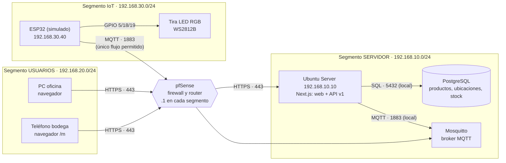

# Parte 0 — Arquitectura final y justificación

## Qué pide el plan

- **1.1** Elegir entre Telegram e interfaz web, justificar la elección y dejar una sola arquitectura objetivo en diagramas, objetivos, metodología, cronograma y conclusiones.
- **2.1** Explicar el problema y el valor de la solución.
- **2.2** Mostrar una arquitectura integral, con conexiones y protocolos, distinguiendo lo implementado, lo parcial y lo pendiente.
- **2.6** Justificar cada tecnología según la necesidad que cubre.

## 1. El problema

En una bodega pequeña, encontrar un producto depende de la memoria de quien lo guardó. Eso trae tres costos:

- **Tiempo**: se recorren pasillos buscando.
- **Errores**: se saca un producto parecido o de la casilla equivocada.
- **Dependencia de personas**: un operador nuevo no sabe dónde está nada.

**Nuestra solución:** el sistema sabe en qué casilla está cada producto. Cuando alguien lo busca, la pantalla muestra la ubicación (por ejemplo `A-02-06-03`) y además se enciende una luz LED en esa casilla de la estantería. Se automatiza el paso de **"saber dónde está y reconocer la casilla"**: el operador camina directo a la luz.

**Ejemplo de uso:** un operador escribe o escanea `VM-0004` → la pantalla responde "pasillo A-02, rack 6, nivel 3, 12 unidades" → en la estantería parpadea en verde la casilla A-02-06-03 → el operador toma el producto y el stock se descuenta.

## 2. Decisión: interfaz web (se descarta Telegram)

| Criterio | Bot de Telegram | Interfaz web (elegida) |
|---|---|---|
| Facilidad de uso | Comandos de texto; no muestra un mapa ni listas largas | Botones, buscador, mapa 3D; funciona en PC y en el teléfono |
| Seguridad | Depende de la cuenta de Telegram y de los servidores de un tercero | Login propio, contraseñas con hash, roles, todo en nuestro servidor |
| Costo | Gratis | Gratis (software libre); sólo el servidor |
| Tiempo de desarrollo | Rápido para consultas simples, lento para inventario completo | Ya está construida y publicada |
| Escalabilidad | Una conversación por usuario, difícil de auditar | Varios usuarios a la vez y registro de cada movimiento |
| Lector de códigos | No | Sí: lector USB/Bluetooth o cámara del teléfono |

**Conclusión:** Telegram queda descartado. Hay una sola interfaz, la web, con dos vistas: **oficina** (PC) y **modo bodega** (`/m`, teléfono).

## 3. Cambios respecto al informe anterior

El informe 2.5 proponía Flask + SQLite + Telegram. La arquitectura final cambió así:

| Antes | Ahora | Por qué |
|---|---|---|
| Telegram + web | Solo web | Una sola interfaz que proteger y mantener |
| Flask (Python) | Next.js (TypeScript): la página web y la API en una sola aplicación | Menos piezas que instalar y desplegar; la misma validación protege la pantalla y la API |
| SQLite | PostgreSQL | Varios usuarios escribiendo a la vez sin bloquear la base; restricciones de integridad (`CHECK`, claves únicas y foráneas) |
| `GET /api/productos` | `GET /api/v1/stock?sku=…` (y los demás endpoints de [docs/API.md](../API.md)) | La API está versionada y protegida con API key |
| Usuarios en estructuras locales | Tabla `User` con contraseña bcrypt y rol | Corrige la observación 1.5 |
| Mensaje "ACTIVACIÓN DE LED" en consola | Orden MQTT al ESP32 (ver parte 4) | Corrige la observación 1.2 |

## 4. Dos ambientes, el mismo código

| Ambiente | Dónde | Qué se demuestra |
|---|---|---|
| **Producción** | Dominio público, desplegado con Coolify a partir de este repositorio: contenedor Docker (`Dockerfile`, Node 22) + PostgreSQL, HTTPS en el dominio y chequeo de salud en `GET /api/health` | El sistema funcionando para usuarios reales: catálogo, inventario, pedidos, API, mapa 3D |
| **Laboratorio** | Máquinas virtuales en VirtualBox | Lo que un hosting no deja ver: red segmentada con pfSense, reglas de firewall, broker MQTT y el dispositivo IoT recibiendo la orden |

Ambos parten del mismo repositorio y de las mismas variables de entorno (`DATABASE_URL`, `SESSION_SECRET`). Producción construye la imagen Docker; el laboratorio puede usar ese mismo `Dockerfile` o `pnpm build` + `pnpm start`. En los dos casos la app corre en modo producción, no en modo desarrollo (punto 1.7).

## 5. Diagrama de la arquitectura (laboratorio)

Leyenda de flujos:

- Usuarios → servidor: sólo HTTPS (443).
- IoT → servidor: sólo MQTT (1883) hacia el broker. El ESP32 abre la conexión y queda suscrito; por esa conexión recibe las órdenes.
- IoT → usuarios, IoT → Internet, usuarios → base de datos: **bloqueados**.

La matriz de reglas completa con sus pruebas va en la parte 5. En VirtualBox cada segmento es una **red interna**, que cumple el mismo papel que una VLAN en una red física.

## 6. Componentes y estado

| Componente | Tecnología | Estado |
|---|---|---|
| Interfaz web oficina y teléfono | Next.js 15 + React | ✅ Implementado y publicado |
| API REST v1 | Rutas de Next.js (`src/app/api/v1`) | ✅ Implementado · ⏳ pruebas documentadas (parte 3) |
| Base de datos | PostgreSQL 16 + Prisma | ✅ Implementado · ⏳ pruebas de integridad (parte 3) |
| Autenticación y roles | bcrypt + sesión firmada (JWT) + 3 roles | ✅ Implementado · ⏳ pruebas de acceso (parte 2) |
| Mapa 3D con simulación del LED | three.js en el navegador | ✅ Implementado (simulación visual) |
| Publicación MQTT desde el servidor | Mosquitto + cliente MQTT | ⏳ Parte 4 |
| Dispositivo IoT | Firmware ESP32 en `firmware/` | 🟡 Firmware escrito; se ejecuta un ESP32 **simulado** (no hay hardware) |
| Red segmentada y firewall | pfSense en VirtualBox | ⏳ Partes 1 y 5 |

## 7. Por qué cada tecnología

| Tecnología | Necesidad que cubre |
|---|---|
| **Ubuntu Server** | Sistema operativo estable, gratuito y con soporte largo (LTS) para el servidor. Sin escritorio, consume poco. |
| **Next.js** | Una sola aplicación entrega las páginas y la API. Las reglas de permisos se escriben una vez y valen para ambas. |
| **PostgreSQL** | Guarda el inventario sin perder datos y rechaza valores imposibles, como stock negativo o un código duplicado. |
| **Prisma** | Define las tablas en un solo archivo (`prisma/schema.prisma`) y versiona cada cambio como migración. |
| **MQTT + Mosquitto** | Protocolo liviano, pensado para dispositivos pequeños como el ESP32. El servidor publica "enciende A-02-06-03" y el dispositivo suscrito lo recibe al instante. |
| **ESP32** | Microcontrolador barato con Wi-Fi integrado, capaz de manejar tiras LED direccionables. |
| **Tira LED WS2812B** | Cada LED se controla por separado, así una sola tira por pasillo ilumina cualquier casilla. |
| **pfSense** | Firewall libre que separa usuarios, servidor y dispositivos IoT, y deja pasar sólo lo necesario. |

## Evidencia de esta parte

Esta parte es de diseño: la evidencia es este documento, el diagrama de la sección 5 y la [guía simple](guia-simple.md). Las pruebas de funcionamiento quedan en las partes 2 a 5.

## Estado

✅ Arquitectura cerrada: interfaz web, Next.js + PostgreSQL, MQTT hacia ESP32, red segmentada con pfSense. Telegram descartado.
